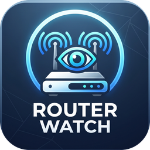

<p align="center">
  
</p>

<h1 align="center">RouterWatch</h1>

<p align="center">
  Android app to monitor your home Wi-Fi and manage the WLAN MAC filter of a Huawei HG8145V5 router, right from your phone.
</p>

---

## About

RouterWatch shows live Wi-Fi health (signal, link speed, router and internet ping) and lets you see every device connected to your router. You can add or remove devices from the router's WLAN MAC filter and turn the whitelist on or off without opening the router's web page.

It talks to the router's own web interface over your local network. No cloud, no account, no analytics.

## Features

- **Live stats**: signal strength (dBm), link speed, band (2.4 / 5 GHz), router ping, internet ping and a ping history bar.
- **Device list**: name, IP, MAC, SSID and online/offline status, with All / Online / Offline filters.
- **MAC filter control**: add a device to the filter list, remove an entry, and view the current list.
- **Whitelist switch**: turn the WLAN MAC filter on or off. The switch shows ON, OFF or UNKNOWN, and never pretends to know a state it cannot read.
- **Tap a device card** to copy its MAC address.
- **Light, dark and system themes.**
- **Saved login**: the router password is encrypted with the Android Keystore (AES-256-GCM). "Forget login" removes it.
- **Debug dialogs** with copyable text when the router replies in an unexpected way, so issues are easy to report.

## Compatibility

| Item | Support |
|------|---------|
| Router | Huawei **HG8145V5** (tested firmware only; other Huawei models may differ) |
| Android | 7.0 (API 24) and newer |
| Connection | Must be connected to the router's Wi-Fi |

Other routers or firmware versions may use different pages and will likely not work.

## Install

1. Open the [Releases](https://github.com/j4eh1/RouterWatch/releases) page.
2. Download `RouterWatch.apk`.
3. Open it on your phone and allow "Install unknown apps" when asked.

The APK is debug-signed, so Play Protect may show a warning. That is expected for apps installed outside the Play Store.

## Usage

1. Connect your phone to the router's Wi-Fi.
2. Open **Account**, enter your router login, then tap **Get devices**.
3. **Devices** tab: tap a card to copy its MAC, or tap **Add to filter list**.
4. **Filter list** tab: remove entries and use the **Whitelist filter** switch.

> **Warning:** before turning the whitelist ON, make sure your own phone is in the filter list. Otherwise the router will block it and you will lose Wi-Fi access.

## Permissions

| Permission | Why |
|-----------|-----|
| `INTERNET` | Talk to the router and run ping checks |
| `ACCESS_WIFI_STATE` / `ACCESS_NETWORK_STATE` | Read signal, link speed and gateway address |
| `ACCESS_FINE_LOCATION` | Android requires it to read the Wi-Fi network name |

## Security notes

- The app only connects to private LAN addresses (`10.x`, `172.16-31.x`, `192.168.x`).
- The router uses a self-signed HTTPS certificate, so certificate checks are skipped **for the router connection only**.
- Cleartext traffic is enabled in the manifest for routers that serve plain HTTP.
- Your login never leaves your phone except to the router.

## Build from source

Requirements: JDK 17, Android SDK 34, Gradle 8.7.

```bash
git clone https://github.com/j4eh1/RouterWatch.git
cd RouterWatch
gradle assembleDebug
```

The APK is written to `app/build/outputs/apk/debug/RouterWatch.apk`.

### GitHub Actions

Every push to `main` builds the APK and uploads it as the `RouterWatch` artifact. Pushing a tag that starts with `v` also publishes a GitHub Release with the APK attached:

```bash
git tag v1.0
git push origin v1.0
```

## Project structure

```
RouterWatch/
├── .github/workflows/build.yml     CI build + release
├── app/
│   ├── build.gradle.kts
│   └── src/main/
│       ├── AndroidManifest.xml
│       ├── java/com/lester/routerwatch/MainActivity.kt
│       └── res/                    launcher icons
├── build.gradle.kts
├── settings.gradle.kts
└── gradle.properties
```

## Disclaimer

Use RouterWatch only on a router you own or are authorized to manage. The app is provided as is, without warranty. Changing router settings can lock you out of your network, so use it carefully.

## Author

Developed by **Lestrrr233** ([@j4eh1](https://github.com/j4eh1)).

Repository: <https://github.com/j4eh1/RouterWatch>
